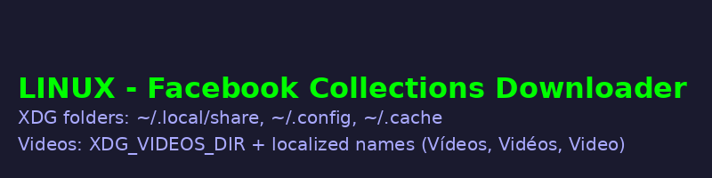
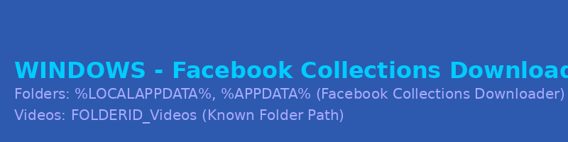
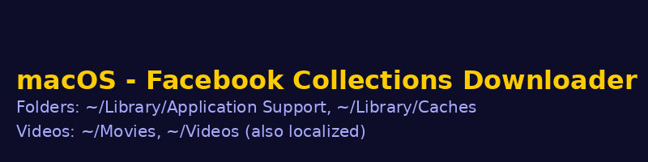

# Facebook Collections Downloader - Manual de Instalación Multi-Platforma

Bienvenido/a a estos tutoriales diseñados para que cualquier persona, independientemente de su nivel técnico, pueda instalar y usar el **Facebook Collections Downloader** en su sistema operativo.

## Índice rápido
1. [Linux](#linux--facebook-collections-downloader)
2. [Windows](#windows--facebook-collections-downloader)
3. [macOS](#macos--facebook-collections-downloader)

---

## Conceptos importantes que debés saber

Antes de empezar, entendé esto: el programa guardará tus datos (recetas, cookies, miniaturas) en carpetas que son estándar en cada sistema operativo. Vos **no** necesitás saber dónde están exactamente, el programa se encarga solo.

**Sobre los comandos que vas a ver:**

- ⏱ **La primera vez que instalés:** Tenés que poner unos comandos para crear un entorno virtual (`venv`) e instalar las librerías necesarias. Es como armar el mueble por primera vez.
- 🔄 **Cada vez que lo usás:** Después de instalarlo una vez, solo necesitás activar el entorno virtual (un "comando de encendido").
- 📦 **Instalación de paquetes:** Los paquetes `pip` solo hay que instalarlos **una sola vez** la primera ocasión. Después, el programa ya los tiene listos.
- ▶️ **Para lanzar el programa:** Siempre vas a need usar el mismo comando para arrancarlo, como si fuera encender la televisión con el control.

Ahora sí, ¡vamos a los tutoriales!

## Linux <a name="linux--facebook-collections-downloader"></a>



### Bienvenido(a) a Linux

Linux es un sistema operativo muy potente y también gratuito. Los comandos que verás a continuación se escriben en lo que llamamos "terminal" o "símbolo del sistema".

### Paso 1: Abre la terminal
- En la mayoría de distribuciones, podés buscar "Terminal" en el menú de aplicaciones
- O presioná `Ctrl + Alt + T` generalmente

### Paso 2: Instalá Python y pip (solo la primera vez)
Escribí en la terminal:

**Ubuntu/Debian:**
```bash
sudo apt update
sudo apt install python3-pip
```

**Fedora:**
```bash
sudo dnf install python3-pip
```

**Arch Linux:**
```bash
sudo pacman -S python-pip
```

### Paso 3: Creamos un "entorno virtual" (solo una vez)

Esto es como crear un espacio aislado para el programa, para no ensuciar el Python de todo el sistema. Es la primera vez que hacés esto:

```bash
python3 -m venv colecciones_venv
```

**¿Qué pasó?** Se creó una carpeta llamada `colecciones_venv` en tu directorio actual. Esto es normal.

### Paso 4: Activá el entorno virtual
**¡Muy importante!** Cada vez que querés usar el programa, tenés que activar esto. Es como encender la computadora:

```bash
source colecciones_venv/bin/activate
```

Verás que tu prompt de terminal cambia, probablemente aparezca `(colecciones_venv)` al inicio. Eso significa que ya está activo.

### Paso 5: Instalá las dependencias (solo una vez)

Dentro del entorno activado, instalamos lo que el programa necesita:

```bash
pip install -r requirements.txt
```

**¡Cuidado!** Este comando puede tardar unos minutos. Es la única vez que lo necesitás poner. Después, el programa ya trae todo instalado.

### Paso 6: Ejecutá la aplicación

Ahora sí, podés iniciar el programa:

```bash
python3 run.py
```

¡Listo! Se abrirá una ventana con el descargador de colecciones de Facebook.

### ¿Cómo sabés si todo funcionó bien?
Si ves una ventana con el fondo oscuro y el título "Facebook Collections Downloader", ¡éxito! Si algo sale mal, copiá el error y buscá ayuda.

### ¿Necesitás volver a usar el programa otro día?
Sólo tenés que:
1. Abrir la terminal
2. Poner `source colecciones_venv/bin/activate` para reactivar el entorno
3. Ejecutar `python3 run.py`

No vuelvas a poner `pip install` ni `python3 -m venv`, ya están hechos.

## Windows <a name="windows--facebook-collections-downloader"></a>



### Bienvenido(a) a Windows

Windows es el sistema que probablemente usás habitualmente. Aquí los pasos son un poco diferentes.

### Paso 1: Abre la línea de comandos
- Presioná la tecla `Windows` y escribí "cmd" o "PowerShell"
- O presioná `Windows + R`, escribí `cmd` y Enter

### Paso 2: Verificá que tenés Python

Abrí el símbolo del sistema y escribí:

```cmd
python --version
```

Si te dice un número de versión, excelente. Si no, necesitás instalar Python:
1. Entrá a [python.org](https://www.python.org)
2. Descargá "Download Python"
3. Durante la instalación, **marcá la casilla** que dice "Add Python to PATH"
4. Seguí los pasos haciendo clic en "Next" hasta terminar

### Paso 3: Creamos un entorno virtual (solo la primera vez)

Igual que en Linux, esto crea un espacio aislado. Escribí en el símbolo del sistema:

```cmd
python -m venv colecciones_venv
```

Se creó una carpeta `colecciones_venv` en tu directorio. Esto es normal.

### Paso 4: Activá el entorno virtual

**¡Importante cada vez!** Activá con:

```cmd
colecciones_venv\Scriptsctivate
```

Verás que tu prompt cambia y al inicio aparece `(colecciones_venv)`. Ya está listo.

### Paso 5: Instalá las dependencias (solo una vez)

Dentro del entorno activado:

```cmd
pip install -r requirements.txt
```

Esperá un poco mientras se instalan las librerías. **Sólo pon esto la primera vez.**

### Paso 6: Ejecutá la aplicación

```cmd
python run.py
```

Se abrirá la ventana de la aplicación. ¡Listo!

### ¿Cómo usálo otro día?
1. Abrí la terminal (cmd o PowerShell)
2. Poné `colecciones_venv\Scriptsctivate` nuevamente
3. Escribid `python run.py`

Nunca más necesitaréis poner `python -m venv` ni `pip install` desde cero. Siempre el mismo rutina: activar y ejecutar.

## macOS <a name="macos--facebook-collections-downloader"></a>



### Bienvenido(a) a macOS

macOS es el sistema que usa las computadoras Apple (MacBook, iMac, etc.). Los pasos son similares a Linux en algunos aspectos.

### Paso 1: Abre la Terminal
- Abrí la aplicación "Terminal" (la encontrás en Aplicaciones > Utilidades)
- O usá Spotlight (Cmd + Espacio) y escribí "Terminal"

### Paso 2: Verificá Python

En la terminal, escribí:

```bash
python3 --version
```

Si obtenés un número, continuá. Si no o querés actualizarlo, entrá a [python.org](https://www.python.org) y descargá la versión para macOS.

### Paso 3: Creamos un entorno virtual (solo la primera vez)

```bash
python3 -m venv colecciones_venv
```

Se creará una carpeta `colecciones_venv`. Normal.

### Paso 4: Activá el entorno virtual

**¡Cada vez que lo uses!**:

```bash
source colecciones_venv/bin/activate
```

Tu terminal cambiará y verás `(colecciones_venv)` al inicio. Ya está activo.

### Paso 5: Instalá las dependencias (solo una vez)

Dentro del entorno activado:

```bash
pip3 install -r requirements.txt
```

Esperá a que termine. **Sólo esta vez.**

### Paso 6: Ejecutá la aplicación

```bash
python3 run.py
```

Se abrirá la ventana. ¡Listo!

### ¿Cómo usálo otro día?
1. Abrí la Terminal
2. `source colecciones_venv/bin/activate` para reactivar
3. `python3 run.py` para lanzar

Nunca más necesitás poner los comandos de venv ni pip desde cero. Siempre la misma rutina: activar y correr.
